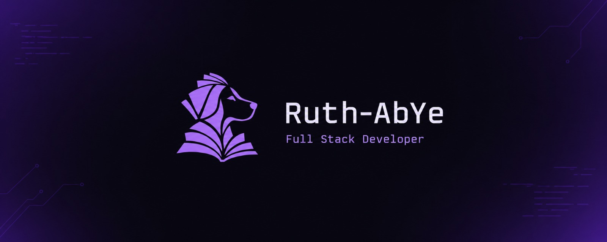

<div align="center">

<!-- BANNER -->



</div>

<div align="center">

### 🙋‍♀️ Sobre mí

</div>


```yaml
nombre:    "Ruth Mery Abello"
ubicacion: "Valledupar, Cesar, Colombia 🇨🇴"
rol:       "Aprendiz ADSO | Estudiante de Ingeniería de Sistemas"
estado:    "En formación y en constante aprendizaje..."
```

- 💻 Construyo aplicaciones web pensadas para resolver problemas reales
- 🧠 Me gusta combinar lógica y creatividad en cada proyecto
- 🔁 Me muevo con soltura entre frontend y backend
- 📐 Priorizo el orden, la escalabilidad y las buenas prácticas
- 🌱  Creadora de **GreenUp**, una plataforma web ambiental orientada a promover el reciclaje
  
- 🎓 Aprendiz SENA (ADSO) y estudiante de Ingeniería de Sistemas
- 🤝 Con toda la disposición para aportar en mi etapa práctica
- 🔌 Desarrollo y consumo de APIs REST`
- 📦 Manejo de datos JSON`
- 🧪 Pruebas de endpoints con Postman`
- 🗄️ Consultas SQL y conexión con bases de datos`
- 🔁 Git Flow, pull requests y revisión de código`
- 🐞 Depuración y manejo de errores`
- 📫 Contáctame: **ruthabelloyepes@gmail.com**

<br clear="right"/>


<div align="center">

### 🛠️ Tecnologías & Herramientas

</div>

#### 💻 Lenguajes

<div align="center">


</div>

#### ⚙️ Backend & APIs

<div align="center">


</div>

#### 🗄️ Bases de Datos

<div align="center">


</div>

#### 🚀 Despliegue & Control de Versiones

<div align="center">


</div>


<div align="center">

### 🌱 Proyecto Destacado

</div>

> **GreenUp** — Plataforma ambiental georreferenciada, pensada para conectar datos de ubicación con acciones o iniciativas ecológicas, combinando desarrollo web con un propósito de impacto real.


<div align="center">

### 📊 Estadísticas de GitHub

Puedes consultar mis repositorios y proyectos directamente en mi perfil de GitHub: [ruth-abello-yepes](https://github.com/ruth-abello-yepes)

</div>


<div align="center">

### 📫 ¿Hablamos?

[](mailto:ruthabelloyepes@gmail.com)
[](https://wa.me/573006003875)

📍 Valledupar, Cesar, Colombia

</div>

<div align="center">


*⭐ Si te gusta mi trabajo, no olvides dejar una estrella en mis repos ⭐*

</div>
